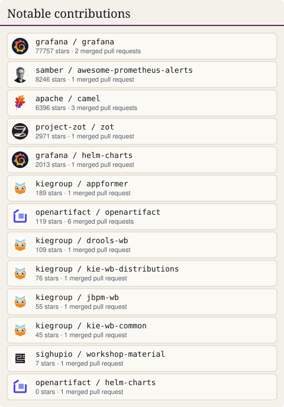

<!-- pyml disable-num-lines 5 first-line-heading -->

<picture>
  <source media="(prefers-color-scheme: dark)" srcset=".github/readme-banner-dark.svg">
  
</picture>

I'm Marco Pernigo. I run release engineering, CI and observability for
[Carbonio](https://github.com/zextras) at Zextras, and I keep a homelab where I
try things before they reach work.

Most of what I build is small infrastructure tooling: GitHub managed from YAML,
Renovate configuration, OpenTelemetry exporters and Grafana dashboards. I keep
it maintained, tested and documented. When something upstream gets in the way, I
send the fix back: Grafana, the Grafana Tempo Helm chart, zot, Apache Camel and
awesome-prometheus-alerts have merged changes of mine.

## What I work on

- **Release engineering:** packaging, Jenkins pipelines and semantic-release for
  the Carbonio services at [Zextras](https://github.com/zextras).
- **Observability:**
  [github-activity-exporter](https://github.com/gjed/github-activity-exporter)
  pushes GitHub pull request, issue and Renovate dashboard metrics over OTLP;
  [jenkins-opentelemetry-dashboards](https://github.com/gjed/jenkins-opentelemetry-dashboards)
  are Grafana dashboards for the Jenkins OpenTelemetry plugin. I also added OTLP
  logs, audit events and frontend telemetry to
  [OpenArtifact](https://github.com/openartifact/openartifact).
- **GitHub as code:**
  [terraform-github-config-as-yaml](https://github.com/gjed/terraform-github-config-as-yaml)
  is a Terraform module that manages a GitHub organization from YAML;
  [github-configs-public](https://github.com/gjed/github-configs-public) manages
  my own repositories with it.
- **Dependencies:** [renovate-config](https://github.com/gjed/renovate-config)
  is the shared Renovate preset and self-hosted GitHub App runner for every gjed
  repository.
- **Homelab:** Kubernetes with k3s and Flux, Proxmox and AWS managed with
  OpenTofu, OPNsense.
- **Talks and workshops:**
  [demo-otel-weaver](https://github.com/gjed/demo-otel-weaver), the demo for a
  talk on OpenTelemetry Weaver;
  [workshop-2026-k8s](https://github.com/gjed/workshop-2026-k8s), a Kubernetes
  workshop for IDI DevOps Bologna 2026.

## Recently merged upstream

<!-- recent-prs:start -->

- [openartifact/openartifact#325](https://github.com/openartifact/openartifact/pull/325): feat(audit): stream audit events as OTLP log events · 2026-10-29
- [openartifact/openartifact#320](https://github.com/openartifact/openartifact/pull/320): feat: experimental frontend telemetry behind a same-origin relay (#222) · 2026-10-29
- [openartifact/openartifact#326](https://github.com/openartifact/openartifact/pull/326): docs(monitoring): state what OTLP log records carry and test the logs startup gate · 2026-10-28
- [openartifact/openartifact#321](https://github.com/openartifact/openartifact/pull/321): feat(telemetry): export application logs over OTLP through the otelzap bridge · 2026-10-28
- [openartifact/openartifact#304](https://github.com/openartifact/openartifact/pull/304): feat(telemetry): count dropped OTLP log records and test against a real collector · 2026-10-28
- [openartifact/helm-charts#17](https://github.com/openartifact/helm-charts/pull/17): openartifact: 0.10.0 (app 0.13.0) · 2026-10-27

<!-- recent-prs:end -->

## Notable contributions

<picture>
  <source media="(prefers-color-scheme: dark)" srcset="metrics/notable-historical-dark.svg">
  
</picture>
